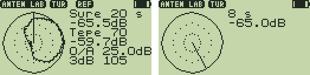

# Anten Lab 1.0 — telsizle anten ışıma diyagramı ölçümü

**Anten Lab**, yönlü bir antenin (Yagi, çerçeve, kendi yaptığınız anten)
**ışıma diyagramını** telsizin RSSI ölçümüyle çıkarır: anteni sabit bir
sinyale (bir işaret verici, röle, arkadaşınızın taşıyıcısı) doğru döndürün,
telsiz her yönde seviyeyi ölçsün ve ekrana **kutupsal diyagramı** çizsin.
Yalnızca alıcıdır, yayın yapmaz.



*(Solda: TUR ölçümü (düz) ve referans (noktalı) üst üste; sağda: tur sürerken.
Test düzeneğinin çizdiği taklitler: `test/test_antenlab.py`.)*

| Ekranda | |
|---|---|
| Diyagram | 0 dB = dış çember, noktalar −10 ve −20 dB, 30 dB'lik aralık; kuzey (0°) yukarıda, saat yönünde. Çizgi: anlık yön / tur ilerlemesi |
| `Tepe` | Ana hüzmenin yönü: −3 dB noktalarının ortası (seviye adımları tepeyi düzleştirdiği için en güçlü kutudan daha doğru) |
| seviye | Tepedeki seviye (dBm, zayıflatıcı telafi edilmiş) |
| `O/A` | Ön/arka oranı (tepe − 180° karşısı) |
| `3dB` | −3 dB hüzme genişliği (komşu 10°'lik kutular arasında doğrusal ara değerleme) |
| ikinci satır | Canlı seviye |

## İki ölçüm modu

**ADIM** (varsayılan): anteni gösterilen yöne (`Yon 120`) çevirin, `MENU`.
Telsiz 16 ölçümün ortalamasını alır (~0.2 s), seviyeye göre perdesi değişen
bir bip çalar ve 10° ilerler. `UP`/`DOWN` yönü elle değiştirir. 36 adımda tam tur.

**TUR** (`1`): `MENU` → 3-2-1 geri sayım bipleri → anteni **saat yönünde,
düzgün hızla, bir tur** döndürün; her 90°'de bir bip hızı tutturmanıza yardım
eder. Süre `2` ile 10 / 20 / 30 / 60 s. Ölçümler zamana göre 36 kutuya
dağıtılır (kutu b = 10b ± 5°). `MENU`/`EXIT` yarıda keser.

## Karşılaştırma ve kayıt

- `4`: o anki diyagram **referans** olur, noktalı çizilir (`REF`). Sonra
  `0` ile silin ve diğer anteni ölçün: ikisi **aynı dB ölçeğinde** üst üste
  görünür — iki anteni, ya da bir ayardan önce/sonrayı kıyaslamak için.
- `5`: referansı göster/gizle.
- Her iki diyagram çıkışta saklanır, telsiz kapanıp açılsa da geri gelir.

## Ölçüm kalitesi için

- AGC kapalı, kazanç sabit (Fox Hunt'ın REG_13 ayarları). Kuvvetli sinyalde
  `3` ile zayıflatıcı: 0 / 6 / 15 / 27 dB; değer okumalara geri eklenir.
  Bir ölçüm boyunca zayıflatıcıyı değiştirmeyin.
- Seviye doğrudan BK4819'un RSSI register'ından (REG_67, **0.5 dB adım**)
  okunur; firmware'in `rssi_dbm()` servisi 1 dB'ye yuvarlar. Banda göre
  düzeltme başlangıçta `rssi_dbm()` ile kalibre edilir.
- Kaynak sabit olmalı (ölçüm boyunca gücü değişmeyen bir işaret verici ideal),
  telsiz ve anten aynı noktada dönmeli, yakın yansıtıcılardan uzak durun.
  Ön/arka oranı ölçüm aralığıyla sınırlıdır (zemin gürültüsü).

## Bilgisayara aktarma

`F` (ya da bilgisayardan `?`) diyagramı CSV olarak USB'ye yazar:
`derece,dBm,ref_dBm`, 36 satır. PC aracı CSV ve SVG çizer, antenleri karşılaştırır:

```bash
python3 tools/antenlab/antenlab.py al yagi.csv
```

```bash
python3 tools/antenlab/antenlab.py ciz yagi.csv dipol.csv -o karsilastirma.svg
```

Örnek çıktı (yapay veri): [`images/ornek-karsilastirma.svg`](images/ornek-karsilastirma.svg).

## Kurulum ve tuşlar

- F4HWN **Labs** v6.3.0+ (API 3, `serial`). Hazır dosya: [`prebuilt/AntenLab.app`](prebuilt/AntenLab.app).

```bash
python3 tools/uvterm/uvterm.py install App/apps/antenlab/prebuilt/AntenLab.app
```

| Tuş | İşlev |
|---|---|
| `MENU` | ADIM: bu yönü ölç; TUR: başlat / durdur |
| `UP`/`DOWN` | Yön ±10° (ADIM) |
| `1` | ADIM ↔ TUR |
| `2` | Tur süresi 10/20/30/60 s |
| `3` | Zayıflatıcı 0/6/15/27 dB |
| `4` / `5` | Referans yap / göster-gizle |
| `0` | Ölçümü sil |
| `F` | CSV'yi USB'ye gönder |
| `EXIT` | Çıkış (ayarlar ve diyagramlar saklanır) |

VFO'yu ölçeceğiniz sinyalin frekansına alıp uygulamayı açın.

## Derleme ve testler

```bash
./compile-app.sh antenlab
```

```bash
python3 App/apps/antenlab/test/test_antenlab.py
```

Test bilinen bir anten simüle eder (tepe 70°, −3 dB hüzme 108°, ön/arka 25 dB,
−60 dBm; `test/host_antenlab.c`): ADIM'da tepe ±2°, hüzme ±6°, ön/arka tam;
TUR'da tepe ±5°; zayıflatıcı telafisi, referans, CSV, yeniden başlatmada geri
gelme, `?` komutu (21 kontrol). `tools/antenlab/test_antenlab_pc.py` PC
aracını ve canlı sanal seri porttan çekmeyi dener (9 kontrol). Gerçek telsiz
ve antenle henüz denenmedi. Kod 3440 B (4096 B overlay).
