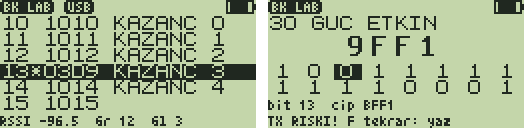

# BK Lab 1.0 — BK4819 register laboratuvarı

**BK Lab**, gömülü geliştirici için telsizin RF çipinin (BK4819 / BK4829)
**register'larını canlı** gösterir, **bit bit düzenletir** ve USB'den
**betikle** okuyup yazdırır: susturucu eşiklerini, AGC/kazanç tablosunu,
filtre bant genişliğini, ton üretecini denemek, bir firmware özelliğinin hangi
register'ı nasıl değiştirdiğini görmek için.



*(Liste ve bit düzenleyici — test düzeneğinin çizdiği taklitler: `test/test_bklab.py`.)*

## Ekranlar

**Liste:** 0x00–0x7F, altı satır, değerler **canlı** okunur (durum ve ölçüm
register'ları kıpırdar). Adlar yalnızca firmware sürücüsünde (`App/driver/
bk4829.c`) kullanımı açık olanlara verildi: `KAZANC 0-4` (0x10–0x14), `AGC`,
`GUC ETKIN` (0x30), `GPIO` (0x33), `PA` (0x36), `FREK ALT/UST` (0x38/0x39),
`FILTRE BW` (0x43), `AF CIKIS`/`AF KAZANC` (0x47/0x48), `SQ GLITCH/GECIKM/
GURULT` (0x4D–0x4F), `CTCSS DCS` (0x51), `FSK…` (0x58–0x5F), `GLITCH`,
`GURULTU`, `RSSI` (0x63/0x65/0x67), `TON…` (0x70–0x72), `MIC HASS`,
`AGC SABIT`… Bu oturumda yazılan register `*` ile işaretlenir. En altta canlı
`RSSI -96.5  Gr 12  Gl 3` (0.5 dB, gürültü, glitch).

**Bit düzenleyici** (`MENU`): değer büyük yazılır, altında 16 bit (üst satır
15–8, alt satır 7–0); imleç `UP`/`DOWN` ile gezer, `MENU` biti çevirir (önce
düzenleme tamponunda), `F` çipe yazar, `*` çipteki değeri geri alır. Altta
imlecin bit numarası ve çipin o anki değeri.

## Güvenlik

- **Korumalı register'lar:** 0x30 (RX/TX etkinleştirmeleri), 0x33 (GPIO —
  PA anahtarı burada), 0x36 (PA). Yanlış bir bit vericiyi açabilir; bunlar
  için `F` önce **uyarır** (`TX RISKI! F tekrar: yaz`), ikinci `F` yazar.
  USB'de `w` reddedilir, `w!` gerekir.
- **Geri yükleme:** uygulama açılışta 128 register'ı okur; çıkışta bu
  oturumda yazılan her register açılıştaki değerine döner (sonra yükleyici
  telsizi zaten yeniden kurar). `geri` komutu bunu çıkmadan yapar.
- Yayın yapan register denemelerini yalnızca yasal frekansta ve uygun güçte,
  tercihen sahte yükle (dummy load) yapın.

## Tuşlar

| Yer | Tuş | İşlev |
|---|---|---|
| Liste | `UP`/`DOWN` (basılı: hızlı) | Register seç |
| | `0`–`7` | 0x00, 0x10 … 0x70'e atla |
| | `MENU` | Bit düzenleyici |
| | `EXIT` | Çıkış (yazılanlar geri yüklenir) |
| Bit düzenleyici | `UP`/`DOWN` | Bit seç |
| | `MENU` | Biti çevir |
| | `F` | Çipe yaz (korumalıda iki kez) |
| | `*` | Çipteki değeri geri al |
| | `EXIT` | Listeye dön (yazılmayan düzenleme atılır) |

## USB komutları

Satır başına bir komut, register ve değerler onaltılık:

| Komut | Cevap |
|---|---|
| `r 13` / `r 10 4` | `13=03DF` / dört satır |
| `w 13 03D9` | yazar, okuyup `13=03D9` |
| `w! 30 BFF1` | korumalı register'a yazar |
| `d` | 16 satır: `00: 1000 1001 …` |
| `s` | `RSSI -96.5  Gr 12  Gl 3` |
| `m 67 250` | her 250 ms'de (onluk) `67=007F`; herhangi bir bayt durdurur |
| `geri` | `# geri yuklendi N` |

PC kabuğu ve Python API'si: [`tools/bklab/README.md`](../../../tools/bklab/README.md).

```bash
python3 tools/bklab/bklab.py
```

```text
bk> r 13
13  03DF  0000 0011 1101 1111  KAZANC 3
bk> tara 4F 0400 0A00 100 200
bk> kaydet once.txt
```

## Kurulum

- F4HWN **Labs** v6.3.0+ (API 3, `serial`). Hazır dosya: [`prebuilt/BKLab.app`](prebuilt/BKLab.app).

```bash
python3 tools/uvterm/uvterm.py install App/apps/bklab/prebuilt/BKLab.app
```

## Derleme ve testler

```bash
./compile-app.sh bklab
```

```bash
python3 App/apps/bklab/test/test_bklab.py
```

Test, uygulamayı sahte bir BK4819 ile çalıştırır (128 register RAM'de): liste
gezinme ve sarma, bit düzenleme, korumalı register onayı ve başka tuşla
iptali, çıkışta geri yükleme, tüm USB komutları, `CR LF` ile izleme (21
kontrol). PC aracının testleri uygulamaya sanal seri porttan canlı bağlanır
(13). Gerçek telsizde henüz denenmedi. Kod 2500 B (4096 B overlay).
