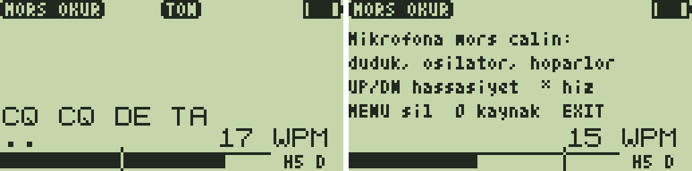

# Mors Okur 1.0 — telsizin mikrofonundan mors çözücü

**Mors Okur**, telsizin **kendi mikrofonunun** duyduğu morsu çözüp ekrana
yazar. Kaynak ne olursa olsun çalışır: ıslık, düdük, mors osilatörü,
bilgisayar ya da telefon hoparlörü, başka bir telsizin hoparlörü. Tonun
perdesi önemli değildir; uygulama sesin yalnızca **genliğine** (zarfına)
bakar.

Çözülen metin USB'den bilgisayara da gider. Uygulama **hiçbir şey
yayınlamaz**: verici devresi kapalıdır.



*(Çözerken ve boş ekran: test düzeneğinin çizdiği taklitler, `test/test_morsokur.py`.)*

## Ekran

- **Üst satır:** `MORS OKUR`. Ses varken (işaret anında) `TON` yanar; yeşil
  LED de aynı anda yanar.
- **Beş satır metin:** satır dolunca yukarı kayar. Türkçe harfler küçük
  harfle gösterilir, çünkü yazı tipinde aksan yok: `c` = Ç, `g` = Ğ,
  `o` = Ö, `s` = Ş, `u` = Ü. Tanınmayan desen `_` olur.
- **Alt satırlar:**
  - O an girilen desen (`-.-.`) ve hız (`18 WPM`).
  - **Seviye çubuğu:** mikrofonun duyduğu, en yüksek işarete göre ölçekli.
    Dikey çizgi işaret eşiğidir; çubuk çizgiyi geçince işaret başlar.
  - Sağ altta hassasiyet (`H5`) ve kaynak (`D`/`R`, aşağıda).

## Tuşlar

| Tuş | İşlev |
|---|---|
| `UP` / `DOWN` | Hassasiyet 1–9 (varsayılan 5). Gürültülü odada düşür, uzak ve zayıf seste artır |
| `*` | Hızı sıfırla (15 WPM). Çok farklı hızda biri başlarsa |
| `MENU` | Metni temizle |
| `0` | Mikrofon kaynağı `D` / `R` (aşağıda) |
| `EXIT` | Çıkış (alıcı eski haline döner) |

## Nasıl çalışıyor

**Mikrofon:** telsizde mikrofon yalnızca BK4819'un mikrofon ADC'sine
bağlıdır. Uygulama bu ADC'yi ve TX DSP'yi açar, DSP'nin ölçtüğü ses
genliğini (REG_64) okur. Bu, firmware'in mikrofon çubuğu ve VOX'un okuduğu
değerdir.
- `D` kaynağı: REG_30 = 0x0306 (AF DAC, diskriminatör, mikrofon ADC, TX
  DSP). **PLL, VCO, PA ve RF yolu kapalıdır; RF çıkamaz.**
- `R` kaynağı: alıcı açık kalır, üstüne mikrofon ADC'si ve VOX dedektörü
  açılır (REG_30 = 0xBFF5, REG_31 bit 2). `D` kaynağında çubuk hiç
  oynamıyorsa `0` ile bunu deneyin.
- Çıkışta REG_31 eski değerine döner, `tones_off_rx` alıcıyı yeniden kurar.

**Zarf ve eşik:**
- 2 ms'de bir okunur, art arda üç okumanın ortancası alınır (tekil
  sıçramalar atılır).
- İşaretler arasındaki, eşiğin altında kalan okumalar "sessizlik" sayılır.
  Sessizliğin seviyesi ve yayılımı (ortalama sapması) odayı izler.
- İşaret, sessizlik ile en yüksek işaretin ortasında başlar. Bu eşik
  sessizliğe hiçbir zaman şundan daha fazla yaklaşmaz:
  `(14 − hassasiyet) / 2` yayılım ya da sessizliğin
  `(10 − hassasiyet) / 16`'sı. İşaret bu eşiğin yarısında biter
  (histerezis).
- Bir kenar için art arda üç aynı karar gerekir.
- 2 saniyeden uzun ses mors değildir (konuşma, fan); yeni sessizlik
  seviyesi olarak alınır.

**Nokta, çizgi, hız:**
- Son 8 işaretin en kısası ile en uzunu arasında 2 kat fark varsa sınır
  ikisinin ortasıdır, yoksa iki noktadır.
- Nokta süresi her işaretle güncellenir; iki kattan fazla saparsa
  (yeni hız) yolun dörtte üçünü bir anda gider. WPM = 1200 / nokta (ms).
- 2 nokta sessizlik harfi, 5 nokta kelimeyi bitirir. Bunlar 1/3 ve 3/7
  boşluklarının tam ortalarıdır.

**USB:** bağlanınca `# Mors Okur 1.0 ready` gelir, ardından çözülen her harf
geldiği anda. Uzun bir duraklamadan sonra satır sonu gönderilir. `/echo off`
yanıtlanır, yani `uvterm.py` ile kullanılabilir.

## Kullanım ipuçları

- Mikrofon telsizin ön yüzündedir. Ses kaynağını 10–30 cm'ye getirin.
- En iyi sonuç 500–1000 Hz civarında temiz bir tonla alınır: osilatör ya da
  bilgisayarda bir mors sitesi. Islıkla da çalışır.
- Önce `VVV` ya da birkaç harf gönderin; hız 1–2 harfte oturur.
- Çubuk kımıldıyor ama `TON` yanmıyorsa hassasiyeti artırın. Gürültüden
  `E T` gibi harfler çıkıyorsa azaltın.

## Kurulum

- F4HWN **Labs** v6.3.0+ (API 3, `serial`).
- Hazır dosya: [`prebuilt/MorsOkur.app`](prebuilt/MorsOkur.app).

```bash
python3 tools/uvterm/uvterm.py install App/apps/morsokur/prebuilt/MorsOkur.app
```

Uygulamayı açmak için: **F + 7** → Apps → **Mors Okur**. Bilgisayarda metni görmek
için:

```bash
python3 tools/uvterm/uvterm.py
```

## Derleme ve testler

```bash
./compile-app.sh morsokur
```

```bash
python3 App/apps/morsokur/test/test_morsokur.py
```

Test, uygulamayı sahte bir mikrofonla çalıştırır: REG_64, verilen mors
desenini zamanda izler; gürültü, el titremesi ve kenar gecikmesi eklenebilir
(`test/host_morsokur.c`). 17 kontrol var:
- 15, 25 (15'ten başlayıp uyum sağlayarak) ve 6 WPM.
- ±%20 el titremesi.
- Sessizliğin yalnızca 2,1 katı bir ton ve ±60 gürültü.
- Türkçe harfler.
- 2,5 sn'lik sürekli ses.
- 10 sn'lik yalnız oda gürültüsünden harf çıkmaması.
- Satır kaydırma.
- Register yazmalarında RF bölümünün hiç açılmaması.
- `0` kaynağı ve REG_31'in geri yüklenmesi.
- Hassasiyet tuşları, `MENU`, USB.

Ayrıca bir tarama yapıldı: hız × koşul, 7 kelimelik bir mesaj.
- **5–20 WPM:** her koşulda (anahtarlayıcı, ±%20 el, zayıf ton, 15 ms
  gecikme, zayıf ton + el) 7/7 kelime doğru.
- **25–40 WPM:** 6/7. Yalnızca ilk kelime, 15 WPM'den uyum sağlanırken
  kayboluyor.

**Gerçek telsizde henüz denenmedi.** REG_64'ün telsizde bu iki kaynakta da
mikrofonu ölçtüğü firmware'in mikrofon çubuğu ve VOX koduna dayanan bir
çıkarım. İlk denemede seviye çubuğuna bakın: ses yapınca oynamıyorsa `0` ile
kaynağı değiştirin.

Kod 2476 B (4096 B overlay).
