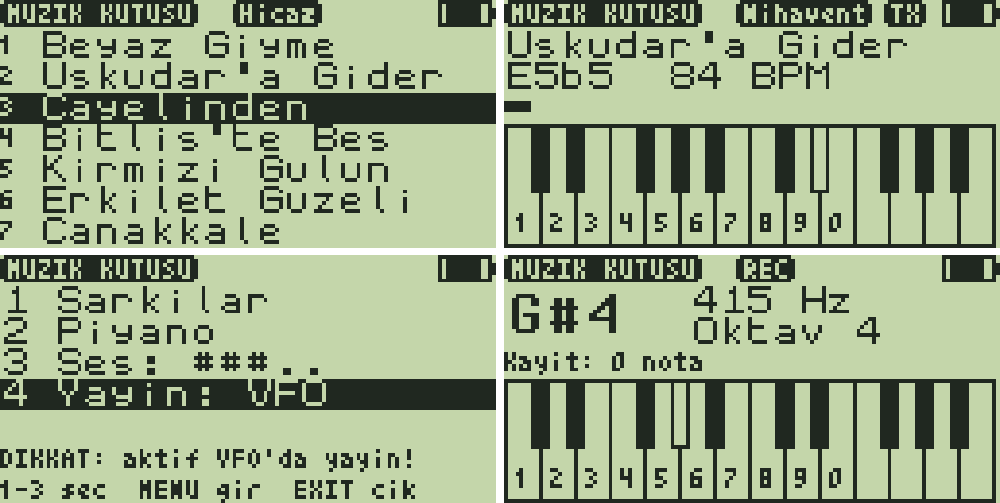

# Müzik Kutusu 2.0 — türküler, hicaz, piyano, MIDI ve VFO'da yayın

**Müzik Kutusu**, telsizi tek sesli bir çalgıya çevirir:
- Makam perdeleriyle (53-TET koma) **türküler ve hicaz**.
- Tuş takımıyla **piyano**, kapatıp açınca kaybolmayan bir **kayıtla**.
- USB üzerinden bilgisayardan **MIDI**: `.mid` çalma, MIDI klavye ve `.mid`'i
  uygulamaya **gömme** ([`tools/muzik/muzik.py`](../../../tools/muzik/README.md)).

Sürüm 2.0 iki şey getiriyor:
- **Yayın:** menüde açılınca müzik hoparlör yerine **aktif VFO'dan
  yayınlanır**.
- **Liste:** eski batı melodileri çıkarıldı, listede yalnızca türküler var.
  Kendi şarkıların için yer açmak üzere Çayelinden ve Kırmızı Gülün de
  çıkarıldı.



*(Şarkı listesi, VFO'da çalarken, yayın açık menü, piyano: test düzeneğinin
çizdiği taklitler, `test/test_muzik.py`.)*

## Bölümler

| | |
|---|---|
| **1 Şarkılar** | 9 türkü, makam perdeleriyle (gerçek koma aralıkları):<br>• **Hicaz:** Bitlis'te Beş Minare, Erkilet Güzeli<br>• **Segah:** Beyaz Giyme (Bolu)<br>• **Nihavent:** Üsküdar'a Gider İken<br>• **Neva:** Çanakkale İçinde<br>• **Hüseyni:** Sarı Gelin, Hey Onbeşli, Ceddin Deden<br>• **Beyati:** Gesi Bağları<br>Seçili şarkının makamı üstteki kapsülde görünür. Çalarken ekranda nota, BPM, ilerleme ve klavye var. Nota adı makam yazımıyla verilir: `F5#3` = fa, 3 koma diyez; `B4b1` = si, 1 koma bemol. |
| **2 Piyano** | Tuş takımı iki oktavlık bir klavyedir: `1`–`0` = do re mi fa sol la si do re mi. `*` sonraki notayı diyez yapar, `UP`/`DOWN` oktavı değiştirir (3–6). Ekranda nota (büyük), frekans (Hz) ve oktav görünür. |
| **Kayıt** | Piyanoda `MENU` kaydı başlatır ve bitirir: notalar ve aradaki sessizlikler, 20 ms çözünürlük, en çok 255 olay. `F` kaydı çalar. Kayıt çıkışta saklanır. |
| **3 Ses** | 5 seviye. Her basışta hoparlörden bir örnek nota çalar. |
| **4 Yayın** | `kapali` / `VFO`. Ayrıntılar aşağıda. |
| **USB** | `n<nota>` (MIDI numarası, 60 = do4) bir notayı başlatır, `x` susturur. Piyanoda çalınan notalar bilgisayara aynı biçimde gider. |

## Yayın: aktif VFO'da müzik

Menüde **4 Yayın: VFO** seçilince şarkılar, piyano ve USB'den gelen MIDI
hoparlör yerine **aktif VFO'nun frekansında FM olarak yayınlanır**:
- Yayın VFO'nun gücü ve CTCSS/DCS'iyle yapılır; Ton Çağrı uygulamasının
  kullandığı yolun aynısıdır.
- Durum çubuğunda `TX` yazar, LED yanar.
- İlk notadan önce 300 ms taşıyıcı verilir, böylece karşı tarafın
  susturucusu açılır.
- Verici, son notadan 2 s sonra bırakılır.

Güvenlik için:
- Yayın her açılışta **kapalı** başlar ve kaydedilmez.
- Firmware izin vermezse müzik hoparlörden çalar. Bunun nedenleri: yayın
  yasağı olan bant (TX kilidi), düşük ya da fazla yüksek pil, FM dışı
  modülasyon.
- Menüdeki ses örneği her zaman hoparlörden çalar.
- **3 dakika** kesintisiz yayından sonra verici bırakılır ve yayın kendiliğinden
  kapanır.

> **Yasal not:** Amatör bantlarda müzik yayını (ITU Radyo Tüzüğü md. 25 ve
> BTK amatör telsiz yönetmeliği) ve PMR446'da müzik yasaktır. Bu modu
> yalnızca sahte yükte (dummy load), kendi test düzeneğinde ya da müziğe
> izin verilen bir frekans ve lisansla kullanın; sorumluluk kullanıcıdadır.
> Telifli eserleri yayınlamak ayrıca telif hakkını da ihlal eder.

## Kendi şarkıların (Kurtlar Vadisi vb.)

Telifli eserler uygulamayla dağıtılmaz. Sahip olduğun bir MIDI dosyasını
kendi telsizin için uygulamaya gömebilirsin:

```bash
python3 tools/muzik/muzik.py gom kurtlarvadisi.mid --baslik "Kurtlar Vadisi" --sure 40
```

```bash
./compile-app.sh muzikkutusu
```

```bash
python3 tools/uvterm/uvterm.py install App/apps/muzikkutusu/MuzikKutusu.app
```

`gom` şöyle çalışır:
- Melodiyi çıkarır: her an çalan en tiz nota alınır, davul kanalı atlanır.
- Notaları 1/32'lik ızgaraya oturtur, oktavları do3–do7 aralığına katlar.
- 1/16'dan kısa susları önceki notaya katar; uygulama notaları zaten
  ayırdığı için staccato bir dosya yarı yarıya az yer tutar (`--suslar`
  hepsini korur).
- RIFF kabuklu `.rmi`/RMID dosyalarını da okur.
- Sonucu `sarkilar/kendi.txt` dosyasına yazar. Bu dosya git'e girmez ve
  şarkıları listenin başına gelir.

Seçenekler:
- `--bas`/`--sure`: dosyanın bir bölümünü (saniye) alır.
- `--kanal`: melodinin bulunduğu MIDI kanalını seçer.
- `--transpoze`, `--hiz`, `--bpm`: perdeyi ve tempoyu ayarlar.
- `--makam`: üst kapsülde görünecek etiketi verir.
- Aynı başlıkla yeniden gömmek eskisinin yerine yazar.

Bir şarkının sınırları:
- En çok 255 nota, 15 farklı perde, 16 farklı uzunluk. Sınıra gelen
  şarkıyı `gom` keser ve nedenini söyler.
- Varlık alanı dolarsa `gen_assets.py`, listenin sonundaki şarkıları
  uyarıyla çıkarır.

`kendi.txt` elle de yazılabilir; biçim `gen_assets.py` dosyasının başında
anlatılıyor. Bir şarkı başlık satırıyla başlar, notalar onu izler:

```text
= Baslik | Makam | BPM
C#4/8 B4b1/16 C5#4/8. R/4 A4*5/8
```

- `C#4`: eşit aralıklı nota.
- `B4b1`, `C5#4`: 53-TET nota. Doğal notadan sonra kaç koma diyez (`#`)
  ya da bemol (`b`) olduğu yazılır.
- Uzunluk: `/8` sekizlik, `/8.` noktalı sekizlik, `*5/8` beş sekizlik.

## Türkülerin kaynağı ve lisansı

Türküler [SymbTr](https://github.com/MTG/SymbTr) veritabanından türetildi
(M. Kemal Karaosmanoğlu, *A Turkish makam music symbolic database for music
information retrieval: SymbTr*, ISMIR 2012). Bu yüzden SymbTr'nin lisansı
olan **CC BY-NC-SA 4.0** (ticari olmayan, aynı lisansla paylaş) altındadır:
`sarkilar/turkuler.txt` ve onu içeren `.app`.

Ne alındı:
- Yalnızca anonim türküler ve bestecisi 70 yıldan uzun süre önce ölmüş
  eserler. Ceddin Deden: Kaptanzade Ali Rıza Bey, ölümü 1934.
- Yalnızca perde ve süre, söz yok.
- Her eserin ilk kıtası, ilk söylenen heceden başlayarak.

Dosyayı yeniden üretmek için:

```bash
python3 tools/muzik/symbtr2kutu.py SymbTr/txt > App/apps/muzikkutusu/sarkilar/turkuler.txt
```

## Kurulum

- F4HWN **Labs** v6.3.0+ (API 3, `serial` yeteneği).
- Hazır dosya: [`prebuilt/MuzikKutusu.app`](prebuilt/MuzikKutusu.app).

```bash
python3 tools/uvterm/uvterm.py install App/apps/muzikkutusu/prebuilt/MuzikKutusu.app
```

Uygulamayı açmak için: **F + 7** → Apps → **Muzik Kutusu**.

## Tuşlar

| Yer | Tuş | İşlev |
|---|---|---|
| Menü | `1`–`4`, `UP`/`DOWN` + `MENU` | Bölüm seç. `3` sesi bir kademe artırır, `4` yayını açar/kapatır |
| | `EXIT` | Çıkış (verici bırakılır) |
| Şarkılar | `UP`/`DOWN` | Şarkı seç. Çalarken tempoyu değiştirir (%50–%200) |
| | `MENU` ya da `1`–`9` | Çal / dur |
| | `EXIT` | Dur, sonra menüye dön |
| Piyano | `1`–`0` | Nota (basılı tuttukça çalar) |
| | `*` | Sonraki nota diyez |
| | `UP`/`DOWN` | Oktav |
| | `MENU` | Kayıt başlat / bitir (`REC`) |
| | `F` | Kaydı çal / durdur |
| | `EXIT` | Menüye dön |

## Nasıl çalışıyor

**Şarkı biçimi:**
- Her şarkı kendi perde paletini (en çok 15 perde) ve uzunluk tablosunu
  (ms cinsinden) taşır.
- Her nota tek bayttır: üst 4 bit perde, alt 4 bit uzunluk.
- Perdeler ya piyanonun eşit aralıklı tablosundan (do3–do7) ya da
  koma tablosundan gelir. Koma tablosu her perde için REG_71 değerini, en
  yakın klavye tuşunu ve adı tutar.
- Koma frekansı: 440 · 2^((k−305)/53) Hz. REG_71 = Hz × 1353245 / 2¹⁷;
  koma perdeleri bu değere yuvarlanmadan hesaplanır.

**Hoparlörde çalma:**
- Firmware'in bip yolu kullanılır: `prepare_tone`, REG_71'e notanın
  frekansı, susturucu (REG_50) `tx_mute` ile açılıp kapanır.
- Bu yol beklemez, bu yüzden notalar zamanında başlar ve istenen kadar
  sürer.
- 2 s sessizlikten sonra amfi kapanır.

**Yayında çalma:**
- Verici şöyle açılır: `tx_state` izni sorulur, sonra `tx_set_params`,
  REG_70 = 0xC200 (TONE1, kazanç 66), REG_30 = TX bağlantısı.
- Notalar REG_71 ve `tx_mute` ile modüle edilir.
- Kapanış Ton Çağrı uygulamasıyla aynıdır: REG_30 boşta, `tx_end`.

**Kalıcı kayıt:** uygulama `--save-screen` bayrağıyla paketlenir. Çıkışta
kaydı ekran tamponlarına yazar, yükleyici bu tamponları varlıkların son
1024 baytına saklar.

**Boyut:** kod 4068 B (4096 B overlay). Varlıklar 2677 B; bunun 1024 B'ı
kayıt alanı, yaklaşık 1160 B'ı da kendi şarkıların için boş. Bu yer, tam
uzunlukta (255 notalık) dört beş şarkıya yeter.

## Derleme ve testler

```bash
./compile-app.sh muzikkutusu
```

```bash
python3 App/apps/muzikkutusu/test/test_muzik.py
```

Test, çalınan notaları BK4819 yazmalarından (REG_71 = perde) ve susturucu
anahtarlamasından (ms) yeniden kurar. 37 kontrol var:
- İlk üç türkünün her notası, perde ve ±15 ms zamanlamayla; diğerleri
  sırayla.
- Tempo, piyano, kayıt, yeniden başlatmadan sonra kaydın geri gelmesi,
  USB protokolü, ses seviyesi.
- Yayın: verici açılış sırası, ilk notadan önceki 300 ms taşıyıcı, şarkının
  tamamının yayında çalması, 2 s sonra bırakma, firmware reddedince
  hoparlöre dönme, menüdeki ses örneğinin hoparlörde kalması, 3 dakikalık
  zaman aşımı.

Gerçek telsizde henüz denenmedi. **Yayın modunu ilk kez sahte yükte deneyin.**
