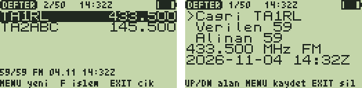

# QSO Defteri 1.0 — telsizde log, bilgisayarda ADIF

**QSO Defteri**, görüşmelerinizi (QSO) doğrudan telsizde kaydeder: sahada,
tepede, araçta kağıt kalem gerekmez. Çağrı işaretini ve raporları yazarsınız;
**frekans ve mod VFO'dan, saat telsizin saatinden** kendiliğinden gelir.
Eve dönünce bilgisayara bağlayıp **ADIF** dosyası alırsınız (Log4OM, N1MM,
QRZ.com, TQSL/LoTW).



*(Liste ve yeni QSO formu — test düzeneğinin çizdiği taklitler: `test/test_defter.py`.)*

## Kullanım

1. **F + 7** → **QSO Defteri**.
2. `MENU`: yeni QSO.
   - **Çağrı**: çoklu basışla büyük harf (`2` = A B C 2 …, `1` = 1 /);
     rakam için tuşu basılı tutun (`TA2ABC` = 8, 2, **2 basılı**, 2, 22, 222).
   - `DOWN` → **Verilen** rapor, `DOWN` → **Alınan** rapor: varsayılan 59,
     rakam yazınca değişir (CW için 599 da olur).
   - Frekans (`145.500 MHz`), mod (FM / AM / SSB) ve UTC saat altta görünür.
   - Aynı çağrı işareti defterde varsa sağ üstte `2 tekrar` (dupe) uyarısı.
   - `MENU` kaydeder, `EXIT` siler / iptal eder.
3. Liste: en yeni üstte, `UP`/`DOWN` ile gezin; seçilinin ayrıntısı altta
   (`57/55 FM 04.11 14:32Z`). Durum çubuğunda `23/50` ve saat.

| Listede | İşlev |
|---|---|
| `MENU` | Yeni QSO |
| `F`, `1` | Saati elle ayarla: `YYAAGGssdd` (ör. `2611041432` = 2026-11-04 14:32 UTC), `MENU` |
| `F`, `2` | Defteri USB'ye CSV olarak gönder |
| `F`, `3`, `3` | Seçili QSO'yu sil (ikinci basış onaydır) |
| `F`, `0`, `0` | Tüm defteri sil |
| `EXIT` | Çıkış |

Defter **50 QSO** tutar ve telsiz kapanıp açılsa da korunur (çıkışta ekran
tamponuna yazılır, yükleyici `APP_FLAG_SAVE_SCREEN` ile saklar). Dolunca
bilgisayara aktarıp boşaltın.

## Saat

Telsizde gerçek zamanlı saat yoktur. Saat **bilgisayardan** (`qsodefteri.py
saat` ya da `al` otomatik ayarlar) ya da **elle** (F+1) kurulur, sonra
telsizin açılıştan beri sayan sayacıyla ilerler. Telsiz kapatılıp açıldıysa
(sayaç geri gittiyse) saat `--:--` olur ve yeniden kurulana kadar QSO'lar
saatsiz kaydedilir. Saat UTC'dir (Türkiye = UTC+3). Derin uyku (`SetOff`)
sayacı durdurabilir: uzun aradan sonra saati kontrol edin.

## Bilgisayara aktarma (ADIF)

```bash
python3 tools/qsodefteri/qsodefteri.py al defter.adi --cagri TA2XX --kare KN50TR --temizle
```

Saati ayarlar, defteri alır, `defter.adi` (ADIF 3.1.4) ve `defter.csv` yazar,
onay sorup telsizdeki defteri boşaltır. `--kare`: Maidenhead kareniz (Bolu
merkezi `KN50TR`). Saatsiz QSO'lar dışarıda bırakılır ve bildirilir;
`--zamansiz "2026-11-04 14:00"` ile hepsine bir zaman verilebilir. Ayrıntı:
[`tools/qsodefteri/README.md`](../../../tools/qsodefteri/README.md).

USB komutları (kendi programınız için): `/saat <unix>`, `/liste` (CSV:
`call,khz,unix,rst_s,rst_r,mode`, sonda `# tamam`), `/temizle`.

## Kurulum

- F4HWN **Labs** v6.3.0+ (API 3, `serial`). Hazır dosya: [`prebuilt/QSODefteri.app`](prebuilt/QSODefteri.app).

```bash
python3 tools/uvterm/uvterm.py install App/apps/qsodefteri/prebuilt/QSODefteri.app
```

## Derleme ve testler

```bash
./compile-app.sh qsodefteri
```

```bash
python3 App/apps/qsodefteri/test/test_defter.py
```

23 kontrol: çoklu basış + basılı rakamla çağrı, raporlar, VFO frekansı, AF
çıkışından mod (AM), boş çağrı reddi, saat (bilgisayardan, elle, geçersiz
tarih, yeniden başlatmada kaybı, aynı açılışta sürmesi), tekrar uyarısı,
onaylı silme, 50 QSO sınırı ve kaydırma, yeniden başlatmada defterin geri
gelmesi, CSV ve `/temizle`. PC aracının testleri (`tools/qsodefteri`)
uygulamaya sanal seri porttan canlı bağlanır. Gerçek telsizde henüz denenmedi.
Kod 3896 B (4096 B overlay).
