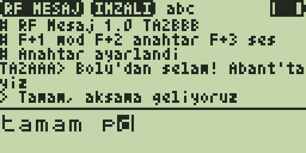

# RF Mesaj 1.0 — iki telsiz arasında dijital mesajlaşma

**RF Mesaj**, aynı uygulamayı yüklemiş telsizler arasında **havadan metin
mesajı** gönderir: tuş takımıyla yaz, `MENU`'ye bas, arkadaşının ekranına
düşsün; o da alındı onayı göndersin. Telsiz USB-C ile bir bilgisayara
bağlıysa mesajlar bilgisayara da gider: [`tools/rfmesaj/rfkopru.py`](../../../tools/rfmesaj/README.md)
ile **Telegram'a köprü** ya da `!hava`, `!saat` gibi **otomatik cevaplar**
(sahada internet yokken bile evdeki bilgisayar üzerinden dış dünyaya ulaşmak).



*(Ekran, test düzeneğinin çizdiği taklittir: `test/test_rfmesaj.py`.)*

## Nasıl çalışır

| | |
|---|---|
| Modem | BK4819'un donanım **FSK** modemi, 1200 bit/s, mesaj başına bir 72 baytlık paket (BEAM uygulamasının telsizler arasında denenmiş register dizileri). Bir mesaj ~0.6 s yayın. |
| Frekans | **O anki VFO.** İki telsiz aynı frekansta, **FM** modunda olmalı. Güç, bant genişliği VFO'dan gelir. |
| Paket | sihirli sayı, bayraklar, sıra no, rastgele nonce, **gönderenin çağrı işareti (açık)**, 48 karakter metin, 32 bit imza, CRC-16 (donanım CRC'si de açık). |
| Çağrı işareti | Telsizin **açılış mesajından** (menü `PonMsg`) okunur; her pakette açık metin olarak gider (istasyon tanıtımı). Boşsa `NOCALL`. |
| İmza | Ortak bir **parola** (F+2) iki telsizde de aynı girilir; anahtar = parolanın XTEA tabanlı özeti (96 bit). Her mesaj XTEA CBC-MAC ile imzalanır: başka anahtarla gelen mesaj `?` ile işaretlenir, onaylanmaz. |
| Gizli mod | İsteğe bağlı (F+1): metin XTEA sayaç kipinde şifrelenir (önce şifrele, sonra imzala). **Bkz. yasal uyarı.** |
| Onay | İmzası doğru her mesaja alıcı 150–660 ms rastgele bekleyip otomatik **alındı (ACK)** gönderir. Gönderen 3 s bekler, gelmezse **toplam 3 kez** dener; ekranda `# + aldi: TA2BBB` ya da `# x iletilemedi`. Tekrar gelen paket bir kez gösterilir, yeniden onaylanır. |

> [!CAUTION]
> **Şifreleme ve yasalar:** ITU Radyo Tüzüğü 25.2A ve ulusal amatör telsiz
> yönetmelikleri, amatör bantlarda **anlamı gizleyen şifreli yayını yasaklar**.
> Varsayılan mod **IMZALI**'dır: metin açık gider, imza sadece mesajın
> sizin grubunuzdan geldiğini doğrular (anlamı gizlemez). **GIZLI** modu
> yalnızca şifrelemenin yasal olduğu durumlarda (ör. sahte yük / dummy load
> ile deney) kullanın; açıldığında telsiz uyarı satırı gösterir.
>
> Yayını yalnızca lisansınızın izin verdiği frekans ve güçte yapın. Firmware'in
> TX kilidi, pil ve FM denetimi (`tx_state`) yayına izin vermezse uygulama
> göndermez: `# x TX yok (kilit/pil/FM degil)`.

## Modlar (durum çubuğundaki kutucuk)

| Kutucuk | Anlamı |
|---|---|
| `HERKES` | Anahtar yok: herkese açık, imza herkes için aynı (doğrulama anlamsız), `?` ile görünür |
| `IMZALI` | Anahtar var, metin açık, imzalı. Aynı anahtarlılardan gelenler `TA2AAA> ...`, diğerleri `TA2AAA? ...` |
| `GIZLI` | Anahtar var, metin şifreli + imzalı. Aynı anahtarla çözülen `TA2AAA* ...`, çözülemeyen `TA2AAA? (cozulemedi)` |

## Kurulum

- F4HWN **Labs** v6.3.0+ (API 3, `serial` yeteneği).
- Hazır dosya: [`prebuilt/RFMesaj.app`](prebuilt/RFMesaj.app) — **her iki telsize de** yükleyin.
- Telsizin açılış mesajına çağrı işaretinizi yazın (menü `PonMsg`).

```bash
python3 tools/uvterm/uvterm.py install App/apps/rfmesaj/prebuilt/RFMesaj.app
```

İlk kullanım (iki telsizde de aynı):

1. VFO'yu boş, yasal bir simplex frekansa alın (ör. arkadaşınızla anlaştığınız bir 2 m / 70 cm frekansı), FM.
2. **F + 7** → **RF Mesaj**.
3. **F, 2** → parolayı yazıp `MENU` (`# Anahtar ayarlandi`). Durum `IMZALI` olur.
4. Mesajı yazıp `MENU`.

## Tuşlar

| Tuş | İşlev |
|---|---|
| `0`–`9` | Çoklu basış (telefon gibi); basılı tutmak rakamı yazar |
| `*` | `abc` → `ABC` → `123` |
| `MENU` | Gönder (yayın sırasında üstte `TX`) |
| `EXIT` | Sil; basılı tutmak satırı temizler; boşken çıkış |
| `UP` / `DOWN` | Geçmişi kaydır |
| `F`, `1` | GIZLI modu aç/kapat (anahtar gerekir, uyarı gösterir) |
| `F`, `2` | Anahtar: sonraki satır + `MENU` parola olur (gönderilmez) |
| `F`, `3` | Gelen mesaj bip sesi aç/kapat |

Mesaj en fazla 48 karakter (iki satırlık yazma alanı kayar). Ayarlar (mod,
anahtar, ses) kaydedilir; geçmiş çıkışta silinir.

## Bilgisayar ile (USB)

Telsiz USB-C ile bağlıyken:

- bilgisayardan gelen her satır **havaya gönderilir** (48 karakter),
- alınan mesajlar ve `# ...` durum satırları bilgisayara yazılır,
- `/key <parola>` anahtarı ayarlar, `/echo off` → `# echo off`
  (bu sayede `uvterm.py` ile de sohbet edilebilir).

Bilgisayar ASCII göndermelidir: `rfkopru.py` Türkçe harfleri `c g i o s u`'ya
çevirir; başka UTF-8 karakter telsizde `?` olur.

```bash
python3 tools/rfmesaj/rfkopru.py --anahtar bolu-ortak-anahtar
```

Telegram köprüsü ve otomatik cevaplar: [`tools/rfmesaj/README.md`](../../../tools/rfmesaj/README.md).

## Bilinen sınırlar

- Aynı anda yalnızca bir mesaj onay bekler; yenisi gönderilince eskisi bırakılır.
- Kanal meşguliyeti dinlenmez (CSMA yok); onaylar rastgele gecikmeyle çakışmayı azaltır.
- Yayın sırasında (~0.6 s) alma yapılmaz; USB'den gelen veriler tamponda bekler.
- Şifreleme hobi düzeyindedir: XTEA, 96 bit anahtar, 32 bit nonce, 32 bit imza.
  Gerçek gizlilik gerektiren işler için uygun değildir.
- Gerçek telsizlerde henüz denenmedi: FSK dizileri BEAM'den alındı ama VFO
  frekansında, BEAM'in sabit kanalı yerine kullanılıyor.

## Derleme ve testler

```bash
./compile-app.sh rfmesaj
```

```bash
python3 App/apps/rfmesaj/test/test_rfmesaj.py
```

Test, uygulamayı bilgisayarda sahte bir BK4819 FSK modemiyle çalıştırır: bir
telsizin havaya bastığı paket (`AIR`) diğerine verilir. 33 kontrol: paket
biçimi, imza ve şifre (bağımsız bir Python XTEA/CBC-MAC/CTR uygulamasıyla
karşılaştırılarak), onay ve 3 deneme, tekrar eleme, başka anahtar, bozuk
paket, donanım CRC hatası, GIZLI mod, tuşla anahtar girişi (kaydedilen anahtar
Python'un hesapladığıyla aynı), TX reddi, USB. Kod 3972 B (4096 B overlay).
