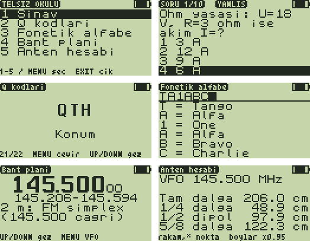

# Telsiz Okulu 1.0 — amatör telsizciliği telsizin üstünde öğren

**Telsiz Okulu**, F4HWN **Labs** firmware'i için Türkçe bir öğretici overlay
uygulamasıdır. Sınava hazırlanan ya da yeni başlayan amatörler için beş bölüm
içerir. Telsiz hiçbir şey yayınlamaz.



*(Ekranlar test düzeneğinin firmware fontlarıyla çizdiği taklitlerdir:
`test/test_okul.py`.)*

| Bölüm | Ne yapar |
|---|---|
| **1 Sınav** | 10 soruluk turlar. 30 soruluk hazır banka + her seferinde üretilen sorular: Q kodu → anlamı, anlamı → Q kodu, "14.215 MHz hangi amatör bandıdır?", Ohm yasası. Şıklar karışık gelir; en iyi puan kaydedilir. |
| **2 Q kodları** | 22 Q kodu kartı (QRA … QTR). Kod büyük yazılır, `MENU` anlamını gösterir: kendini sına. |
| **3 Fonetik alfabe** | Çağrı işaretini tuşlarla yaz (`TA1ABC`), altında ITU fonetiğiyle okunuşu çıkar: *Tango Alfa One Alfa Bravo Charlie*. Boşken tüm alfabe listelenir. |
| **4 Bant planı** | VFO'daki frekansın ne olduğunu söyler: "2 m: FM simplex (145.500 çağrı)", "2 m: Dijital (144.800 APRS)", "70 cm: Uydu", "Havacılık telsizi (AM)"… `UP`/`DOWN` ile tüm planı gez. |
| **5 Anten hesabı** | VFO frekansı (ya da yazdığın MHz) için tam dalga boyu ve 1/4, 1/2 (dipol), 5/8 dalga anten boyları (×0.95 kısaltma payıyla). |

Metinler Türkçedir ama telsizin fontunda Türkçe harf olmadığı için ASCII
yazılır (ç→c, ğ→g, ı→i, ö→o, ş→s, ü→u).

## Gereksinimler ve kurulum

- F4HWN **Labs** v6.3.0 veya sonrası (overlay API seviyesi 3). Özel bir
  yetenek (capability) istemez.
- Hazır dosya: [`prebuilt/TelsizOkulu.app`](prebuilt/TelsizOkulu.app).
- UV Studio ile ya da terminalden yükleyin:

```bash
python3 tools/uvterm/uvterm.py install App/apps/telsizokulu/prebuilt/TelsizOkulu.app
```

Telsizde **F + 7** → Apps → **Telsiz Okulu** → `MENU`.

## Tuşlar

| Yer | Tuş | İşlev |
|---|---|---|
| Ana menü | `1`–`5` | Bölüme doğrudan gir |
| | `UP`/`DOWN`, `MENU` | Seç, gir |
| | `EXIT` | Uygulamadan çık |
| Sınav | `1`–`4` | Cevap ver: doğru şık ters (inverse) yanar, üstte `DOGRU` / `YANLIS`, ses |
| | herhangi bir tuş | Sonraki soru |
| | sonuç ekranında `MENU` | Yeni tur |
| Q kodları | `MENU` | Anlamı göster / gizle |
| | `UP`/`DOWN` | Önceki / sonraki kart |
| Fonetik | `0`–`9` | Çoklu basış (`2` = A B C 2 …, `1` = 1 /); basılı tutmak rakamı yazar |
| | `EXIT` / `MENU` | Son karakteri sil / hepsini temizle |
| | `UP`/`DOWN` | Listeyi kaydır |
| Bant planı | `UP`/`DOWN` | Plan girdilerini gez (üstte başlangıç frekansı) |
| | `MENU` | VFO frekansına dön |
| Anten | `0`–`9`, `*` | MHz yaz, `*` ondalık nokta (ör. `433*5`) |
| | `EXIT` / `MENU` | Sil / VFO frekansına dön |
| Her yerde | `EXIT` | Bir üst menüye dön |

## İçerik ve doğruluk

- **Soru bankası** (30 soru): CQ, 73, MAYDAY/PAN PAN, RST 59, SWR, röle,
  CTCSS, 2 m çağrı ve APRS frekansları, VHF/UHF/HF aralıkları, yayılım,
  desibel, `TA` öneki, BTK, FM/SSB, susturucu, seri/paralel direnç, QSL,
  2 m röle kaydırması (600 kHz), ISS 145.800, `/M`, `/P`…
- **Bant planı:** IARU Bölge 1 2 m ve 70 cm planlarının **özeti** ve birkaç
  servis (FM yayın, havacılık, deniz VHF, PMR446). Bölüm sınırları
  yaklaşıktır; ulusal plan ve BTK düzenlemeleri esastır.
- **Anten boyları:** dalga boyu = c / f; çubuk ve tel antenlerde fiziksel boy
  yaklaşık %5 kısadır (×0.95). Başlangıç değeridir: SWR ölçerek budayın.

Kendi sorularınızı eklemek için `gen_assets.py` içindeki `FIX` listesine
`(soru, doğru, yanlış1, yanlış2, yanlış3)` ekleyip yeniden derleyin (cevaplar
en fazla 16 karakter). Varlık alanı 3840 baytla sınırlı; uzun metinler bir
sözlükle sıkıştırılır (bkz. aşağı).

## Nasıl çalışıyor

- Uzun metinler (sorular, bant planı, Q kodu anlamları) `gen_assets.py`
  içinde açgözlü bir alt dizi sözlüğüyle sıkıştırılır: en çok yer kazandıran
  alt dizi `0x80 + k` baytı olur. 4598 B'lık içerik 3600 B civarına iner;
  telsizdeki açıcı (`unz`) 140 bayttır.
- Rastgelelik firmware'in `rand32` servisinden gelir; bir turda hazır
  sorular tekrar etmez.
- Kod 4044 B (4096 B overlay'in %98'i), varlıklar 3600 B civarı.

## Derleme ve testler

```bash
./compile-app.sh telsizokulu
```

```bash
python3 App/apps/telsizokulu/test/test_okul.py
```

Test, uygulamayı bilgisayarda sahte bir firmware API'siyle
(`App/apps/host_mock.h`) çalıştırır: 40 turun her sorusunu (400 soru) veriyle
karşılaştırır (işaretli şık gerçekten doğru mu, dört şık farklı mı, soru ekrana
3 satırda sığıyor mu), ayrıca puan/ses/kayıt, menü, kartlar, fonetik
yazıcı, bant planı bulma ve anten girişini denetler. Uygulama henüz gerçek bir
telsizde denenmedi.
