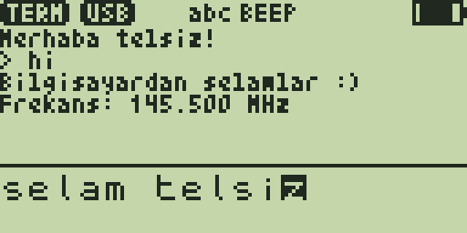

# USB Term 2.0 — telsiz ile bilgisayar arasında terminal

**USB Term**, F4HWN **Labs** firmware'i için bir overlay uygulamasıdır. Telsizi
(UV-K1 / UV-K5 V3) USB-C kablosuyla bilgisayara bağlar ve iki yönlü bir metin
terminali kurar:

- **Bilgisayar → telsiz:** terminalde yazdığınız her satır telsizin ekranında
  görünür (32 sütun × 6 satır, 32 satırlık geri kaydırma).
- **Telsiz → bilgisayar:** telsizin tuş takımından (eski telefonlardaki gibi
  çoklu basışla) yazdığınız satır `MENU` ile bilgisayara gönderilir. Yazma
  alanı ekranın altındaki **iki satır, büyük (6×7) font** (18 + 18 karakter).
- **Komutlar:** bilgisayardan `/info`, `/beep`, `/clear`… göndererek telsizin
  frekansını, RSSI'sini, pil gerilimini sorabilir, bip çaldırabilirsiniz.

Uygulama **hiçbir zaman RF yayını yapmaz**: sadece USB üzerinden konuşur.



*(Ekran, test düzeneğinin çizdiği taklittir: `test/test_term.py`.)*

Bilgisayar tarafı için iki seçenek var:

1. **`tools/uvterm/uvterm.py`** — bu depo ile gelen Python programı: telsizi
   kendisi bulur, renkli/zaman damgalı sohbet, kayıt (log) dosyası, dosya
   gönderme, ayrıca telsize `.app` yükleme ve yüklü uygulamaları listeleme.
2. **Herhangi bir seri terminal** — PuTTY, `screen`, `minicom`,
   `python -m serial.tools.miniterm`, Arduino Serial Monitor… Telsiz yazılanı
   geri yansıttığı (echo) için düz bir konsol gibi çalışır.

Genel Labs uygulama geliştirme / yükleme kılavuzu:
[`../LABS_UYGULAMA_KILAVUZU.md`](../LABS_UYGULAMA_KILAVUZU.md).

## Sürümler

- **2.0** — Yazma alanı büyüdü: telsizde yazdığınız metin artık ekranın
  altında, çizginin altındaki iki satırda büyük 6×7 fontla (18 + 18 karakter)
  ve blok imleçle görünür. Geçmiş 6 satır (32 satır geri kaydırma aynı).
- **1.0** — İlk sürüm.

## Gereksinimler

| Gerekli | Neden |
|---|---|
| F4HWN **Labs** firmware, v6.3.0 veya sonrası (overlay API seviyesi 3) | Overlay uygulamaları ve `serial_*` servisleri yalnızca Labs sürümünde var. Diğer sürümler uygulamayı `CAP` / `ABI` hatasıyla reddeder. |
| USB-C veri kablosu | Telsiz USB-C üzerinden bir USB seri port (CDC ACM, VID:PID `36B7:FFFF`) olarak görünür. Sadece şarj eden kablolar çalışmaz. |
| Bilgisayarda Python 3.8+ ve `pyserial` (sadece `uvterm.py` için) | `pip install pyserial` |

Sürücü gerekmez: Windows 10/11, Linux ve macOS'ta CDC seri port yerleşiktir.
Linux'ta port `/dev/ttyACM0`, macOS'ta `/dev/cu.usbmodem…`, Windows'ta `COMx`
olur. Linux'ta portu açabilmek için kullanıcınızın `dialout` (bazı
dağıtımlarda `uucp`) grubunda olması gerekebilir.

## Kurulum

Hazır derlenmiş dosya: [`prebuilt/USBTerm.app`](prebuilt/USBTerm.app). Kendiniz
derlemek için aşağıdaki **Derleme** bölümüne bakın.

**A) UV Studio ile** (önerilen, tarayıcıdan): [UV Studio](https://armel.github.io/uvstudio/)'yu
Chrome/Edge gibi Web Serial destekli bir tarayıcıda açın, telsizi **normal
modda** (ana ekranda) bağlayın, uygulama (Apps) yönetiminde boş bir slota
`USBTerm.app` dosyasını yükleyin.

**B) Terminalden `uvterm.py` ile:**

```bash
pip install pyserial
```

```bash
python3 tools/uvterm/uvterm.py install App/apps/usbterm/prebuilt/USBTerm.app
```

Telsiz ana ekranda (VFO) ya da Apps menüsünde olmalı; açık bir uygulama
varsa önce `EXIT` ile kapatın. `uvterm.py` aynı adlı uygulama varsa onun
slotunu (ve ayarlarını) korur, yoksa ilk boş slotu kullanır. Yüklü
uygulamaları görmek için:

```bash
python3 tools/uvterm/uvterm.py apps
```

## Kullanım

1. Telsizde **F + 7** ile Apps menüsünü açın, **USB Term**'i seçip `MENU`'ye basın.
2. Telsizi USB-C ile bilgisayara bağlayın. Durum çubuğunda `USB` görünür
   (bir program portu açmamışsa `NO USB`).
3. Bilgisayarda:

```bash
python3 tools/uvterm/uvterm.py
```

ya da bir seri terminal açın (hız önemsiz, USB CDC'de yok sayılır):

```bash
python3 -m serial.tools.miniterm /dev/ttyACM0 115200
```

```bash
screen /dev/ttyACM0 115200
```

Windows'ta PuTTY: *Connection type: Serial*, *Serial line: COM5*, *Speed: 115200*.

### `uvterm.py` sohbet ekranı

```text
uvterm - /dev/ttyACM0 açık. Telsizde USB Term uygulamasını açın (F+7 -> USB Term). Yardım: /help, çıkış: /quit
[telsiz hazır - yazıp Enter'a basın, çıkmak için /quit]
PC> Selam telsiz, nasılsın?
PC> /info
  · USB Term 2.0 / F4HWN Labs v6.3.0
  · RX 145.50000 MHz  -97 dBm
  · BAT 7.85 V  lost 0
[21:16:16] TELSİZ> selam pc
PC> /quit
```

| `uvterm.py` seçeneği | Ne yapar |
|---|---|
| `uvterm.py` | Sohbet (port otomatik bulunur) |
| `uvterm.py -p COM5` / `-p /dev/ttyACM0` | Portu elle seçer |
| `uvterm.py --log sohbet.txt` | Sohbeti zaman damgasıyla dosyaya da yazar |
| `uvterm.py send "metin" ["2. satır" …]` | Satır(lar)ı gönderip çıkar (betikler, cron için) |
| `uvterm.py ports` | Seri portları listeler, telsizi işaretler |
| `uvterm.py apps` | Telsizde yüklü overlay uygulamalarını listeler |
| `uvterm.py install X.app [--slot N] [-y]` | `.app` dosyasını telsize yükler |

Sohbet içindeki komutlar: `/quit` çıkış, `/send dosya.txt` bir metin dosyasını
satır satır gönderir, `/help` yardım. `/info`, `/ping`, `/beep`, `/clear`,
`/echo on|off` telsize gider (aşağıya bakın).

## Telsizdeki tuşlar

| Tuş | İşlev |
|---|---|
| `0`–`9` | Çoklu basış (telefon gibi): `2` = a b c 2, `3` = d e f 3, … `7` = p q r s 7, `9` = w x y z 9. Aynı tuşa 0,9 s içinde tekrar basmak bir sonraki harfe geçer; hâlâ değiştirilebilen harf ters (inverse) gösterilir. |
| `0` | boşluk, `0` |
| `1` | `. , ? ! - ' / : @ ( ) + = * # 1` |
| Rakam tuşunu basılı tutmak | Doğrudan rakamı yazar |
| `*` | Giriş modu: `abc` → `ABC` → `123` (kaydedilir) |
| `MENU` | Satırı bilgisayara gönderir (ekranda `> metin` olarak görünür) |
| `EXIT` | Son karakteri siler; basılı tutmak satırı temizler; **satır boşken uygulamadan çıkar** |
| `UP` / `DOWN` | Geçmişte yukarı / aşağı kaydırır (basılı tutunca tekrarlar). Kaydırılmışken durum çubuğunda `^N` görünür |
| `F` | Gelen mesaj bip sesini açar / kapatır (`BEEP`, kaydedilir) |

Giriş satırı en fazla 64 karakterdir. Bilgisayar portu açmamışken `MENU`
düşük bir hata sesi verir ve satır silinmez; bağlantı gelince tekrar
gönderebilirsiniz.

## Ekran

| Yer | Gösterir |
|---|---|
| Durum çubuğu | `TERM`, `USB` / `NO USB` (bir program portu açık mı: DTR), giriş modu (`abc`/`ABC`/`123`), `BEEP` ya da kaydırma `^N`, pil |
| Üstteki 6 satır (küçük 3×5 font) | Gelen satırlar ve `> ` ile başlayan gönderdikleriniz; bilgisayarın henüz bitmemiş satırı en altta canlı görünür |
| Çizginin altındaki 2 satır (6×7 font) | Telsizde yazdığınız satır ve blok imleç. Çoklu basışta henüz değişebilen harf ters görünür. İkinci satır dolunca metin bir satır yukarı kayar (64 karaktere kadar). |

Gelen her satırda arka ışık yanar, yeşil LED kısa yanıp söner ve (`BEEP`
açıksa) kısa bir bip çalar. 32 karakterden uzun satırlar alt satıra kayar.

## Komutlar (bilgisayar → telsiz)

Tek başına bir satır olarak gönderilir, büyük/küçük harf fark etmez. Komut
satırları telsiz ekranında gösterilmez; yanıtlar `# ` ile başlar.

| Komut | Yanıt |
|---|---|
| `/help` | Komut listesi |
| `/info` | `# USB Term 2.0 / F4HWN Labs v6.3.0`, `# RX 145.50000 MHz  -97 dBm`, `# BAT 7.85 V  lost 0` |
| `/ping` | `# pong` (uygulama açık mı testi) |
| `/beep` | Telsiz bip çalar, `# beep` |
| `/clear` | Telsiz ekranındaki geçmişi siler, `# clear` |
| `/echo off` / `/echo on` | Yansıtmayı (echo) kapatır / açar |

`/foo` gibi tanınmayan bir `/` satırı normal metin olarak gösterilir.

## Protokol (kendi programınızı yazmak için)

- Düz metin, satır sonu `CR`, `LF` ya da `CR LF`. Telsiz `CR LF` gönderir.
- Telsizin her yanıt satırı `# ` ile başlar; diğer satırlar telsizde yazılan
  mesajlardır. Port her açıldığında (DTR yükselince) telsiz
  `# USB Term 2.0 ready - /help` satırını gönderir ve echo'yu yeniden açar.
- **Echo** (varsayılan açık): telsiz aldığı baytları geri gönderir, geri silme
  (`BS`/`DEL`) için `BS SP BS` yollar. Satır tabanlı bir program bağlanınca
  önce `/echo off` göndermeli (yanıt: `# echo off`).
- Terminalin ok tuşları gibi ANSI kaçış dizileri (`ESC [ …`) yok sayılır.
- UTF-8 Türkçe harfler (`ç ğ ı İ ö ş ü`, büyükleri, ayrıca `â î û é ä à è`)
  telsizde ASCII karşılığıyla (`c g i I o s u`) gösterilir; diğer ASCII dışı
  karakterler `?` olur. Echo'da baytlar olduğu gibi geri gider.
- Telsizin alma tamponu 256 bayttır ve her 10 ms'de okunur: uzun metinleri
  parça parça gönderin (`uvterm.py` 32 baytlık parçalar arasında 50 ms bekler).
  Taşma olursa `/info` içindeki `lost` sayacı artar.

Python ile en kısa örnek:

```python
import serial  # pip install pyserial

with serial.Serial("/dev/ttyACM0", 115200, timeout=1) as s:
    s.write(b"/echo off\r\n")
    s.write("Merhaba telsiz!\r\n".encode())
    s.write(b"/info\r\n")
    for _ in range(6):
        print(s.readline().decode(errors="replace").rstrip())
```

Telsizden gelen satırları bir betiğe bağlamak da mümkün (ör. telsizden
`isik ac` yazınca bilgisayarda bir komut çalıştırmak): `classify()` ve
`Chat` sınıfı `tools/uvterm/uvterm.py` içinde.

## Bilinen sınırlar

- Uygulama açıkken telsiz normal telsiz işlevlerini (dinleme, tarama, PTT ile
  yayın) yürütmez; tüm overlay uygulamalarında olduğu gibi `EXIT` ile çıkınca
  ana ekrana dönülür.
- Sadece USB-C: K-plug (programlama kablosu) seri portu firmware API'sinde
  henüz yok.
- Geçmiş telsizin RAM'inde tutulur, uygulamadan çıkınca silinir. Sadece giriş
  modu ve `BEEP` ayarı kaydedilir.
- Ekranda yalnız ASCII görünür.

## Derleme

Docker ile (deponun kökünde):

```bash
./compile-app.sh usbterm
```

Çıktı: `build/Apps/USBTerm.app`. Yerel bir `arm-none-eabi-gcc` varsa Docker'sız:

```bash
cd App/apps/usbterm && ./build.sh
```

Çıktı: `App/apps/usbterm/USBTerm.app` (3084 B / 4096 B overlay + 557 B varlık).

## Testler

```bash
python3 App/apps/usbterm/test/test_term.py
```

```bash
python3 tools/uvterm/test_uvterm.py
```

- `test/test_term.py` uygulamayı bilgisayar için ortak sahte firmware
  API'siyle (`App/apps/host_mock.h`, firmware'in kendi fontları) derler ve 54
  kontrol çalıştırır: echo, satır sonları, geri silme, ANSI dizileri, UTF-8
  dönüşümü, satır kaydırma, tüm komutlar, çoklu basış, uzun basış, modlar,
  `EXIT`, ayarların kaydı, geri kaydırma, iki satırlık yazma alanı. Ayrıca **uçtan uca**: gerçek uygulama kodu ile
  `uvterm.py` bir sanal seri port (pty) üzerinden konuşur. Ekran taklitlerini
  `test/out/*.png` olarak çizer.
- `tools/uvterm/test_uvterm.py` (29 kontrol) `uvterm.py`'nin yükleme/listeleme kodunu,
  firmware'in seri protokolünü (`App/app/uart.c`, `App/apps/app_overlay.c`)
  bayt bayt taklit eden sahte bir telsize karşı çalıştırır.

Bu testler gerçek donanımın yerini tutmaz: uygulama ve `uvterm.py install`
henüz gerçek bir telsizde denenmedi.
